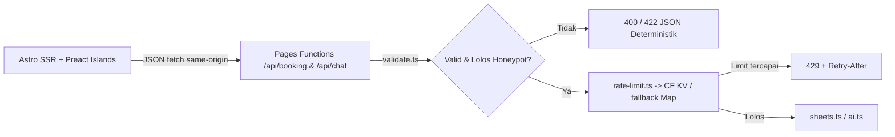

# `.agent/ARCHITECTURE.md` — `web-apps-beauty-care`

> **BYME_SDLC V1.0 — Phase 3 (Context Repo · Structural Map)** · **Kode:** `ARCH-BEAUTY-v1.0`  
> **Sumber Spec:** `TSD-BEAUTY-v1.0` (`LOCKED`) + `PRD-BEAUTY-v1.0` (`FROZEN`) · **Owner:** Zero (Tech Lead) · **Diperbarui:** `2026-11-12`  
> **Aturan Hidup:** Dokumen ini adalah peta navigasi kode nyata ("Where is X?"). Setiap PR/commit yang menambah modul atau mengubah batas layer **wajib** memperbarui file ini di commit yang sama.

---

## 1. Bird's-Eye Overview & Runtime Shape
- **Masalah & Bentuk Solusi:** Mengganti chat manual klinik kecantikan/salon dengan live demo web terukur (`Aurelia Skin Clinic [DEMO]`) berbasis **Astro 5 SSR on-demand + 3 Preact Islands** di **Cloudflare Pages + Cloudflare KV**, terhubung server-side ke Google Sheets API v4 (Service Account) & TokenHarbour `:free` OpenAI-compatible API (`Rp 0/bulan`).
- **Entrypoint Utama:**
  - Halaman Utama SSR: `src/pages/index.astro`
  - Endpoint API Edge (Pages Functions): `src/pages/api/booking.ts`, `src/pages/api/chat.ts`, `src/pages/api/health.ts`
  - Styles & Token CSS: `src/styles/global.css` (`@theme` Tailwind v4 dari `.agent/DESIGN.md`)

---

## 2. Peta Direktori & Modul Kunci (*Code Map — Where is X?*)
```text
web-apps-beauty-care/
├── .agent/                      # Konteks agen (RULES, ARCHITECTURE, KNOWLEDGE, ORCHESTRATOR, TASK, DESIGN, SKILLS, WORKFLOWS)
├── src/
│   ├── lib/
│   │   ├── catalog.json         # Katalog statis 8 treatment (id, kategori, nama, durasi_menit, harga_idr, persiapan)
│   │   ├── validate.ts          # Validasi booking & chat deterministik + normalisasi WA + anti-formula-injection
│   │   ├── rate-limit.ts        # Fixed-window per-IP via Cloudflare KV (fail-open in-memory fallback)
│   │   ├── sheets.ts            # Google Sheets API v4 client (JWT SA WebCrypto RS256 -> append Client_Leads & Appointments)
│   │   ├── ai.ts                # Grounding prompt katalog + guardrail non-medis + TokenHarbour fetch (<=15s) + fallback
│   │   └── errors.ts            # Helper JSON response deterministik (200/201/400/422/429/502/504) & security headers
│   ├── components/
│   │   ├── CatalogFilter.tsx    # Preact Island 1: filter chip kategori & emit event/state pilih treatment ke BookingForm
│   │   ├── BookingForm.tsx      # Preact Island 2: form 3-kolom + slot jam + preserve-input error + Kartu Konfirmasi BK-XXXX
│   │   └── AiChatDrawer.tsx     # Preact Island 3: FAB thumb-zone + bottom-sheet (mobile) / 380px drawer + quick chips + fallback
│   ├── pages/
│   │   ├── index.astro          # SCR-01 Showcase + Hero + Alur 3 Langkah + SCR-02/03 Islands + SCR-04 Footer
│   │   └── api/
│   │       ├── booking.ts       # POST /api/booking (FR-02)
│   │       ├── chat.ts          # POST /api/chat (FR-03)
│   │       └── health.ts        # GET /api/health (Ops)
│   └── styles/
│       └── global.css           # Tailwind CSS 4 + token Clinical Warm Editorial + tabular-nums
└── tests/
    ├── unit/                    # Vitest: validate, sheets sanitizer, rate-limit, ai grounding & guardrail
    ├── integration/             # Vitest (mock fetch): booking 201/400/422/429/502 & chat 200/422/429/504
    └── e2e/                     # Playwright: WebKit @390 + Chromium @1280 (0 scroll-x, CLS=0, pre-fill, AI drawer)
```

| Modul / Area | Path Persis | Tanggung Jawab Utama | Ref. PRD/TSD |
|---|---|---|---|
| Katalog & Domain Data | `src/lib/catalog.json` | Sumber tunggal 8 treatment, harga IDR, durasi, persiapan | `FR-01`, `TSD §5` |
| Validasi & Sanitasi | `src/lib/validate.ts` | Validasi booking/chat, normalisasi WA, `sanitizeSheetCell()` | `FR-02`, `TSD §4.2, §6.2` |
| Rate Limit & Idempotency | `src/lib/rate-limit.ts` | Limit per-IP via CF KV (`3/jam` booking, `15/jam` chat) + dedup 15m | `TSD §5, §6.1` |
| Google Sheets Client | `src/lib/sheets.ts` | JWT Service Account via WebCrypto + 2x `values:append` (`timeout 10s`) | `FR-02`, `TSD §4.2, §6.1` |
| AI CS Client & Guardrail | `src/lib/ai.ts` | Prompt katalog, filter diagnosis/obat medis, fetch LLM `<=15s`, fallback | `FR-03`, `TSD §5, §6.1` |
| UI Islands | `src/components/*.tsx` | 3 island terisolasi (`CatalogFilter`, `BookingForm`, `AiChatDrawer`) `<45KB` gzip | `SCR-01..03`, `DESIGN.md` |

---

## 3. Alur Eksekusi & Data Utama (*Life of a Request*)

1. **Ingress (`src/pages/api/*.ts`):** Route tipis membaca JSON body + IP header CF -> panggil `validate.ts` & `rate-limit.ts`.
2. **Domain & Adapter (`src/lib/sheets.ts`, `src/lib/ai.ts`):** Semua harga & durasi diambil dari `catalog.json` di server (input harga dari klien diabaikan). Panggilan eksternal dibungkus `AbortController` (`10s` Sheets, `15s` AI).
3. **Response (`src/lib/errors.ts`):** Kembalikan status HTTP deterministik (`200/201/400/422/429/502/504`) + security headers (`nosniff`, `DENY`).

---

## 4. Batas Layer & Invariants (*Wajib & Terlarang*)
- **DILARANG melompati layer:** Komponen `.tsx` dan `.astro` tidak boleh memanggil Google Sheets API, TokenHarbour API, atau membaca secret env secara langsung; seluruh panggilan eksternal wajib lewat `/api/*` -> `src/lib/*`.
- **Single Source of Truth Katalog:** Daftar layanan & harga **hanya** berasal dari `src/lib/catalog.json` — baik UI kartu, dropdown booking, server validator, maupun system prompt AI CS membaca sumber yang sama.
- **Zero Server Node-only Dependencies di Edge:** Adapter Cloudflare Pages menggunakan WebCrypto (`crypto.subtle`) dan `fetch()` standar untuk signing JWT Service Account (hindari `googleapis` Node SDK yang berat & tidak kompatibel dengan Workers runtime).

---

## 5. Data Stores, Env Contract & Integrasi
- **Store Aktif:** Google Spreadsheet Demo Sandbox (2 tab: `Client_Leads`, `Appointments`, append-only) + Cloudflare KV namespace (`RATE_LIMIT_KV`, TTL 15–60 menit).
- **Variabel Lingkungan Wajib (nama kunci saja — nilai HANYA di `.dev.vars` / CF Pages Secrets):**
  - `DEMO_SPREADSHEET_ID` (juga URL read-only publik untuk link "Lihat Google Sheet Demo" lewat `PUBLIC_DEMO_SHEET_URL`)
  - `GOOGLE_SERVICE_ACCOUNT_JSON` (email + private_key RSA SA, scope `spreadsheets`)
  - `AI_BASE_URL` (`https://tokenharbor.ai/v1`), `AI_API_KEY`, `AI_MODEL` (`deepseek-v4.1-flash:free`)
  - `PUBLIC_DEMO_WA_NUMBER` (nomor WA fallback demo `628...`), `DISABLE_AI` (`"false"` default kill-switch)

---

## 6. Cross-Cutting Concerns (*Lokasi Implementasi*)
| Aspek | Lokasi File di Repo | Konvensi Wajib |
|---|---|---|
| Input Validation & Sanitizer | `src/lib/validate.ts` | Validasi skema eksplisit + `sanitizeSheetCell()` anti-formula-injection |
| Error & Security Headers | `src/lib/errors.ts` & `src/middleware.ts` | `{ success: false, error: { code, message, ... } }`, `nosniff`, `X-Frame-Options: DENY` |
| Rate Limiter & Idempotency | `src/lib/rate-limit.ts` | KV `{bucket}:{ip}` + `idem:{ip}:{key}` dengan fail-open Map lokal saat KV error |
| Cross-Island State | CustomEvent / lightweight store di `src/lib/events.ts` | `CatalogFilter` / `AiChatDrawer` kirim `treatment_id` -> `BookingForm` prefill + smooth-scroll |
| Healthcheck & Logging | `src/pages/api/health.ts` | `200 { ok, version, ts }`; log JSON tanpa PII/WA penuh |

---

## 7. Keputusan Arsitektur Kunci (ADR Ringkas)
| ID | Keputusan | Alasan Singkat (Ref. TSD §7) | Konsekuensi / Batas |
|---|---|---|---|
| `ADR-001` | **Astro 5 SSR + 3 Preact Islands (CF Pages)** | Bundle JS klien `< 45 KB` gzip, LCP `< 1.0 s`, Rp 0/bulan | Hindari library React berat atau `googleapis` SDK di edge |
| `ADR-002` | **Google Sheets Service Account via WebCrypto JWT** | Kompatibel 100% Cloudflare Workers runtime, nol dependency eksternal | Private key SA disimpan sebagai secret env JSON |
| `ADR-003` | **Validator manual deterministik di `validate.ts`** | Nol library ekstra, 100% dapat di-unit-test, error 422 konsisten | Setiap field baru wajib update `validate.ts` + unit test |
